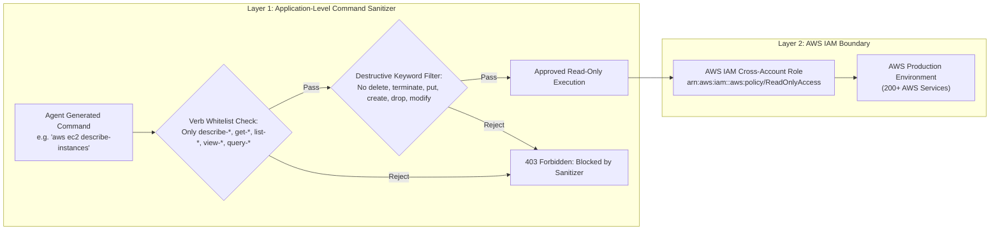

# OneSight — Autonomous Live AWS CLI & Boto3 Investigation Agent

> **Architectural Specification & Security Blueprint:**  
> This document defines the architecture, execution loop, IAM security boundaries, and mandatory safety guardrails for the **Autonomous Read-Only AWS CLI / Boto3 Investigation Agent** in OneSight.

---

## 1. Executive Concept & Vision

When a FinOps engineer asks questions about cloud infrastructure (*"Why did EC2 cost jump?"*, *"Which S3 buckets lack lifecycle rules?"*, *"Are any NAT Gateways or Elastic IPs unassigned?"*), traditional chatbots guess or offer generic advice.

The **OneSight Autonomous Investigation Agent** executes **live AWS CLI and Boto3 API commands dynamically in an iterative loop** until it gathers all necessary telemetry to provide a grounded, verified answer.

### Core Tenets
1. **Zero Hallucination:** Every resource ID, spend figure, and utilization metric cited in the chat originates from an authentic AWS API response.
2. **Iterative Discovery ("Run until answer is found"):** The agent does not stop at high-level spend. It drills down from Cost Explorer ➔ AWS service APIs ➔ CloudWatch metrics ➔ CloudTrail events.
3. **Absolute Non-Destructive Safety:** Enforced via a dual-layer security boundary: AWS IAM `ReadOnlyAccess` + Application-Level Command Sanitization.

---

## 2. Dual-Layer IAM & Application Security Model

To ensure autonomous execution can never accidentally mutate, delete, or disrupt production workloads, the agent operates under a **Defense-in-Depth** security model:



### Layer 1: Application Command Sanitizer
Even if an IAM policy allows an action, the agent runner actively inspects and validates the command string before dispatch:
- **Allowed Command Prefixes:** `describe-*`, `get-*`, `list-*`, `view-*`, `query-*`, `search-*`.
- **Prohibited Mutating Verbs:** `delete`, `terminate`, `put`, `create`, `drop`, `modify`, `update`, `attach`, `detach`, `stop`, `start`, `reboot`, `authorize`, `revoke`.

### Layer 2: AWS IAM ReadOnlyAccess Policy
The Cross-Account IAM Role assumed by OneSight in customer accounts attaches:
- `arn:aws:iam::aws:policy/ReadOnlyAccess`
- `SecurityAudit`

This cryptographically restricts the assumed role credentials to read-only actions at the AWS control-plane level.

---

## 3. The Autonomous ReAct Execution Loop

The agent runs as an iterative **Reason + Act (ReAct)** cycle inside **LangGraph**:

```mermaid
sequenceDiagram
    autonumber
    actor User as User / FinOps Engineer
    participant UI as Chat Console (AgentChatConsole)
    participant LG as LangGraph ReAct Agent
    participant Runner as AWS CLI / Boto3 Executor
    participant AWS as Live AWS Account (ReadOnlyAccess)

    User->>UI: "Which EC2 instances are idle or wasting money?"
    UI->>LG: Start ReAct cycle with user query

    loop Autonomous Investigation Loop (Max 6 Iterations)
        LG->>LG: Thought: "I need to inspect all running EC2 instances across our linked account."
        LG->>Runner: Execute: aws ec2 describe-instances --filters Name=instance-state-name,Values=running --query "Reservations[].Instances[].[InstanceId,InstanceType,LaunchTime]"
        Runner->>AWS: Boto3 ec2.describe_instances()
        AWS-->>Runner: Returns 4 instances: i-0a11, i-0b22, i-0c33, i-0d44
        Runner-->>LG: Formatted JSON with instances

        LG->>LG: Thought: "Now I need 14-day average CPU utilization from CloudWatch for these 4 instances."
        LG->>Runner: Execute: aws cloudwatch get-metric-data --metric-data-queries ...
        Runner->>AWS: Boto3 cloudwatch.get_metric_data()
        AWS-->>Runner: Datapoints: i-0b22 avg CPU = 0.8%, i-0c33 avg CPU = 1.1%
        Runner-->>LG: Metric summary returned

        LG->>LG: Thought: "I have identified 2 underutilized instances (i-0b22, i-0c33). Now checking Mem0 for DR exemptions."
        LG->>Runner: Call tool: mem0_recall_rules("i-0b22 i-0c33")
        Runner-->>LG: i-0b22 is a DR standby (exempted); i-0c33 has zero exemption.

        LG->>LG: Thought: "Investigation complete. Formulating final rightsizing and waste report."
    end

    LG-->>UI: Final Report + Display Executed AWS Commands in Accordion
    UI-->>User: Markdown table with instances, CPU utilization, cost impact, and rightsizing advice!
```

---

## 4. The 4 Essential Production Guardrails

To ensure safety, prevent runaway loops, and protect context windows, the following 4 guardrails are enforced:

### Guardrail 1: Strict Command Sanitizer (Safety Gate)
- **Mechanism:** Programmatic regex and AST parser executed before every command dispatch.
- **Rules:**
  1. Only read-only AWS CLI verbs (`describe-*`, `get-*`, `list-*`, `view-*`, `query-*`) are permitted.
  2. Any command containing mutation verbs (`delete`, `terminate`, `drop`, `modify`, `update`, `put`, `create`, `attach`, `detach`) is immediately blocked and logged as a safety violation.
  3. Commands cannot pipe to shell interpreters (`| sh`, `| bash`, `| powershell`).

### Guardrail 2: Loop Limiter (`max_iterations = 6`)
- **Mechanism:** LangGraph recursion limiter and turn counter.
- **Rules:**
  1. An autonomous investigation cycle is capped at a maximum of **6 tool execution turns**.
  2. If the agent reaches turn 6 without reaching a natural terminal state, the graph forces an immediate transition to the **Response Synthesizer Node**.
  3. The synthesizer formulates the best possible answer using the partial telemetry gathered so far, explicitly noting which commands completed.

### Guardrail 3: Payload Truncation (Context Window Protection)
- **Mechanism:** Token-aware output pruning.
- **Problem:** Commands like `aws ec2 describe-instances` on large AWS organizations can return 20,000+ lines of raw JSON, which would overflow LLM context windows and waste tokens.
- **Rules:**
  1. **JMESPath Encouragement:** The prompt instructs the agent to use `--query` expressions (e.g. `--query "Reservations[].Instances[].InstanceId"`).
  2. **Automatic Truncator:** If raw output exceeds 2,500 tokens (~10,000 characters), the runner automatically retains the top structural slice, summarizes repeating arrays, and appends a `[Truncated: Remaining 120 items omitted]` notice.

### Guardrail 4: Transparent Chat Output & Audit Trail
- **Mechanism:** Real-time tool execution accordion in [`AgentChatConsole.tsx`](file:///d:/One%20Data%20Solution/OneSight/frontend/src/components/AgentChatConsole.tsx).
- **Rules:**
  1. Every command executed by the agent is displayed as a distinct tool badge in the chat UI:
     - `🔧 Executed: aws ec2 describe-instances`
     - `🔧 Executed: aws cloudwatch get-metric-data`
  2. Users can expand the badge to inspect the exact CLI parameters, latency, and sanitized output returned by AWS.
  3. Every command execution is logged to the database in `agent_action_logs` for compliance auditing.

---

## 5. Concrete Real-World Investigation Scenarios

### Scenario A: S3 Cost Surge Investigation
1. **User asks:** *"Why did S3 spend surge this month?"*
2. **Turn 1 (Cost Explorer):**  
   `aws ce get-cost-and-usage --time-period Start=2026-11-01,End=2026-11-22 --granularity DAILY --metrics UnblendedCost --group-by Type=DIMENSION,Key=USAGE_TYPE`  
   *Result:* `TimedStorage-ByteHrs` jumped from $2/day to $18/day.
3. **Turn 2 (S3 Buckets):**  
   `aws s3api list-buckets --query "Buckets[].Name"`  
   *Result:* Returns 6 buckets.
4. **Turn 3 (CloudWatch Metrics):**  
   `aws cloudwatch get-metric-data ... MetricName=BucketSizeBytes, StorageType=StandardStorage, BucketName=data-lake-prod`  
   *Result:* 12TB added to `data-lake-prod` in 48 hours.
5. **Turn 4 (Lifecycle Inspection):**  
   `aws s3api get-bucket-lifecycle-configuration --bucket data-lake-prod`  
   *Result:* `NoSuchLifecycleConfiguration` (Zero lifecycle rules configured).
6. **Final Answer:** Identifies the exact bucket (`data-lake-prod`), lack of lifecycle rules, and calculates prospective savings under Glacier Instant Retrieval.

---

### Scenario B: Unattached EBS Volume Waste Audit
1. **User asks:** *"Are any unattached EBS volumes wasting money?"*
2. **Turn 1:**  
   `aws ec2 describe-volumes --filters Name=status,Values=available --query "Volumes[].[VolumeId,Size,VolumeType,CreateTime]"`  
   *Result:* 3 unattached volumes found (`vol-0a882a6f`, `vol-0b112233`, `vol-0c445566`).
3. **Turn 2 (Mem0 Policy Check):**  
   `mem0_recall_rules("vol-0a882a6f vol-0b112233 vol-0c445566")`  
   *Result:* `vol-0a882a6f` has active exemption (MongoDB DR Standby).
4. **Final Answer:** Lists `vol-0b112233` and `vol-0c445566` as actionable waste ($48.00/mo), while noting that `vol-0a882a6f` was intentionally exempted per team policy.

---

## 6. Implementation Architecture

The capability is implemented as a specialized tool module:
- **Module:** `backend/app/services/aws_command_runner.py`
- **Class:** `AWSReadOnlyCommandRunner`
- **Public Tool Function:** `run_aws_read_only_command(command: str, tenant_id: str) -> Dict[str, Any]`
- **LangGraph Integration:** Registered as a primary tool for the `InvestigatorNode` and `WasteNode` in [`backend/app/services/langgraph_agent.py`](file:///d:/One%20Data%20Solution/OneSight/backend/app/services/langgraph_agent.py).
