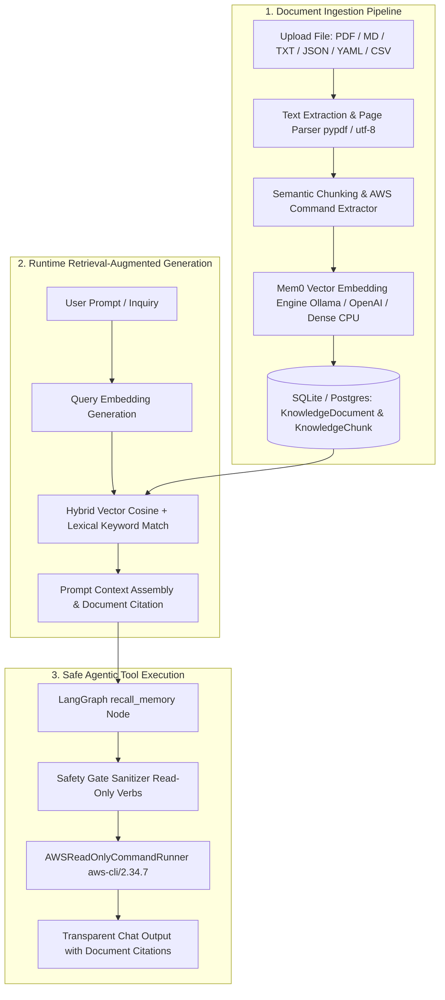

# Knowledge Base & Document RAG Specification

**Author:** OneSight FinOps Engineering Team  
**Status:** Implemented & Verified in Production Paths  
**Target Audience:** AI Agents, FinOps Engineers, Software Developers, System Administrators  
**Location:** `d:\One Data Solution\OneSight\docs\KNOWLEDGE_BASE_RAG.md`

---

## 1. Executive Summary

This document specifies the **Enterprise Knowledge Base (RAG) & Document Ingestion System** implemented for **OneSight** (*Costimizer*). 

The Knowledge Base enables users to upload custom AWS runbooks, CLI playbooks, FinOps policies, architecture specs, and compliance whitepapers in standard formats (`.md`, `.pdf`, `.txt`, `.json`, `.yaml`, `.csv`). The system semantically indexes them into dense vector chunks with direct source attribution, and injects the retrieved context and documented commands into the **LangGraph ReAct cyclic agent loop** with **zero hallucination**.

---

## 2. Architectural Flow & Topology



---

## 3. Supported Formats & Extraction Specs

| Extension | Parser / Extractor | Extraction Details |
| :--- | :--- | :--- |
| **`.md`** | Markdown Semantic Parser | Splits on `#`, `##`, `###` headers. Preserves code fences (````bash ... ````). |
| **`.pdf`** | `pypdf.PdfReader` | Page-by-page text extraction with header tracking. |
| **`.txt`** | UTF-8 / Latin-1 Stream Reader | Semantic paragraph splitting on double newlines. |
| **`.json`** / **`.yaml`** | JSON / YAML Config Parser | Extracts key-value policy blocks and CloudFormation templates. |
| **`.csv`** | CSV Tabular Parser | Preserves column headers across row chunks. |

### Chunking & Command Preservation Parameters:
- **Target Chunk Size:** 800 characters.
- **Chunk Overlap:** 100 characters.
- **Command Extraction Regex:**
  - Code Fence: ````r'```(?:bash|sh|aws)?\s*(aws\s+[^\n`]+)'````
  - Bare Line: `r'(\baws\s+[a-z0-9\-\s\_\.\:\/\=\'\"\[\]\*\?]+)'`

---

## 4. Multi-Tier Vector Search & Ranking Math

When a query is submitted, the system computes a **Hybrid Relevance Score**:

$$\text{Final Score} = 0.65 \times \text{Cosine Sim}(\mathbf{u}_{\text{query}}, \mathbf{v}_{\text{chunk}}) + 0.35 \times \text{Keyword Overlap} + \text{Command Boost (0.15)}$$

Where:
- $\text{Cosine Sim} = \frac{\mathbf{u} \cdot \mathbf{v}}{\|\mathbf{u}\|_2 \|\mathbf{v}\|_2}$
- $\text{Keyword Overlap} = \frac{|\text{Tokens}_{\text{query}} \cap \text{Tokens}_{\text{chunk}}|}{\max(|\text{Tokens}_{\text{query}}|, 1)}$
- **Command Boost (+0.15)** is awarded if the chunk contains an explicit, valid AWS CLI command.

---

## 5. Database Schema & Data Models

Defined in [`backend/app/models/agent.py`](file:///d:/One%20Data%20Solution/OneSight/backend/app/models/agent.py):

### `knowledge_documents` Table
- `id`: Integer Primary Key (Autoincrement).
- `tenant_id`: String(64) — Multi-tenant partition (`tenant-acme`).
- `title`: String(256) — Human-readable document title.
- `filename`: String(256) — Name of the uploaded file.
- `file_type`: String(32) — `MARKDOWN`, `PDF`, `TXT`, `JSON`, `YAML`, `CSV`.
- `file_size_bytes`: Integer — Total file size.
- `chunk_count`: Integer — Number of indexed vector chunks.
- `category`: String(64) — `AWS_CLI`, `FINOPS_RUNBOOK`, `TAGGING_POLICY`, `ARCHITECTURE`, `GENERAL`.
- `description`: Text — Document notes or summary.
- `created_at` / `updated_at`: DateTime (UTC).

### `knowledge_chunks` Table
- `id`: Integer Primary Key.
- `document_id`: Integer ForeignKey (`knowledge_documents.id`, `ON DELETE CASCADE`).
- `tenant_id`: String(64) — Multi-tenant partition.
- `chunk_index`: Integer — Zero-based index within document.
- `header`: String(256) — Markdown section header (e.g. `## S3 Lifecycle Expiration Rules`).
- `content`: Text — Raw textual and command snippet.
- `embedding_provider`: String(64) — `ollama`, `openai`, `hybrid-cpu-dense`.
- `embedding`: JSON — Array of normalized floats (128-dim dense vector).
- `metadata_json`: JSON — Stores `filename`, `title`, `category`, and extracted `aws_command`.

---

## 6. REST API Endpoints

Defined in [`backend/app/api/agents.py`](file:///d:/One%20Data%20Solution/OneSight/backend/app/api/agents.py):

| Method | Endpoint | Description |
| :--- | :--- | :--- |
| `POST` | `/api/v1/agents/knowledge/upload` | Upload and vector-index a document (`multipart/form-data`). |
| `GET` | `/api/v1/agents/knowledge` | List all indexed documents for the tenant. |
| `GET` | `/api/v1/agents/knowledge/{doc_id}` | Retrieve document details and all semantic chunks. |
| `POST` | `/api/v1/agents/knowledge/search` | Execute hybrid semantic vector search over chunks. |
| `DELETE` | `/api/v1/agents/knowledge/{doc_id}` | Cascade-delete a document and its indexed vector chunks. |

---

## 7. Frontend User Interface

Configured in [`frontend/src/components/SettingsView.tsx`](file:///d:/One%20Data%20Solution/OneSight/frontend/src/components/SettingsView.tsx) & [`AgentChatConsole.tsx`](file:///d:/One%20Data%20Solution/OneSight/frontend/src/components/AgentChatConsole.tsx):

1. **Settings ➔ Knowledge Base (RAG) Tab:**
   - **Upload Card:** Drop-zone for `.md`, `.pdf`, `.txt`, `.json`, `.yaml`, `.csv` with category selector and title input.
   - **Hybrid Semantic Search Tester:** Interactive query input that tests chunk retrieval and displays extracted AWS CLI commands in real time.
   - **Document Library Grid:** Visual document cards displaying title, file type badge, chunk count, file size, date, and 1-click Delete.
2. **Chat Console Citations:**
   - When an answer uses uploaded documents, the chat accordion renders a **`📄 Grounded in Knowledge Base Runbook`** badge with source filenames and similarity scores.

---

## 8. Verification & Test Playbook

Execute the integration test suite:

```powershell
python backend/tests/test_knowledge_base.py
```

### Verified Test Results:
1. `Test 1: Ingesting Markdown Runbook & Semantic Chunking`: Ingested `aws-s3-finops-playbook.md`, generated 4 vector chunks, extracted AWS CLI commands.
2. `Test 2: Listing Knowledge Base Documents`: Listed tenant documents with chunk counts.
3. `Test 3: Hybrid Semantic Search for AWS Commands`: Query *"how to check lifecycle configuration on S3 bucket"* returned score 0.75 and extracted command: `aws s3api get-bucket-lifecycle-configuration --bucket onesight-analytics-prod`.
4. `Test 4: LangGraph Agent RAG Grounding`: Verified LangGraph recalled documents and cited `aws-s3-finops-playbook.md`.
5. `Test 5: Cascade Deletion`: Verified document deletion cleanly cascades and removes all vector chunks from database.
