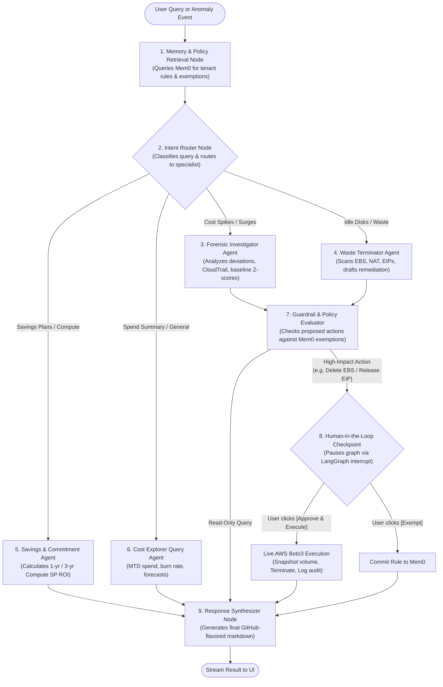

# OneSight — LangGraph Multi-Agent Swarm & Human-in-the-Loop Implementation Plan

> **Document Purpose:**  
> This document details the architectural blueprint, state graph mechanics, specialist agent nodes, and Human-in-the-Loop (HITL) safety workflows for building the enterprise-grade FinOps AI Agent using **LangGraph**.

---

## 1. Executive Summary & Why LangGraph

In enterprise Cloud Financial Management (FinOps), an AI agent cannot simply be a chatbot that dumps text in response to prompts. It must:
1. **Reason cyclically across multiple data sources:** Query Cost Explorer spend, cross-reference CloudWatch CPU telemetry, inspect EBS attachment states, and check organizational policies.
2. **Operate as a Specialized Multi-Agent Swarm:** Delegate complex queries to specialist sub-agents (Forensic Investigator, Waste Hunter, Savings Planner).
3. **Execute High-Impact Actions with Human-in-the-Loop (HITL) Guardrails:** Never delete or snapshot live AWS production assets without pausing execution, generating an Action Proposal Card, and requiring verified human approval.

**LangGraph** was selected because it provides:
- **Cyclic State Graphs:** Allows the agent to loop through `Thought ➔ Tool Call ➔ Observation ➔ Decision`.
- **Native Checkpointing & `interrupt()`:** Built-in ability to pause graph execution before an AWS mutation, save state to the database, wait for the user to click **Approve** in the UI, and resume execution.
- **Universal Multi-Model Support:** Native compatibility with local **Ollama** (`llama3.1`), cloud LPUs via **Groq** (`openai/gpt-oss-120b`), **OpenAI**, and **Gemini**.
- **Multi-Tenant Thread Isolation:** Thread-level state persistence partitioned strictly by `tenant_id`.

---

## 2. LangGraph Architecture & Graph Topology



---

## 3. State Schema (`FinOpsAgentState`)

The central state object tracked across the entire graph lifecycle:

```python
from typing import TypedDict, Annotated, List, Dict, Any, Optional
from langgraph.graph.message import add_messages

class FinOpsAgentState(TypedDict):
    # Core Message History (appended sequentially)
    messages: Annotated[List[Dict[str, Any]], add_messages]
    
    # Multi-Tenant & Account Scope
    tenant_id: str                          # e.g. "tenant-acme"
    account_id: Optional[str]               # e.g. "476383094285"
    user_query: str                         # Raw user query
    
    # Classification & Routing
    intent: Optional[str]                   # ANOMALY, IDLE_WASTE, SAVINGS_PLANS, SPEND_SUMMARY
    
    # Mem0 Layer
    recalled_memories: List[Dict[str, Any]] # Active team rules & exemptions
    
    # Tool Execution Audit Trail
    tool_call_history: List[Dict[str, Any]] # Record of tools executed during graph traversal
    
    # Human-in-the-Loop Remediation Proposal
    action_proposal: Optional[Dict[str, Any]] # {"action": "SNAPSHOT_AND_DELETE", "resource_id": "vol-0a88...", "savings": 48.0}
    approval_status: Optional[str]          # PENDING, APPROVED, REJECTED, EXEMPTED
    
    # Final Output
    final_reply: Optional[str]              # Formatted markdown output
```

---

## 4. Specialist Agent Nodes

### Node 1: Memory & Policy Retrieval (`memory_recall_node`)
- **Inputs:** `user_query`, `tenant_id`
- **Action:** Calls Mem0 service (`http://mem0:8888` or local fallback) using hybrid semantic vector search.
- **Outputs:** Populates `recalled_memories` with matching budget ceilings, resource exemptions (e.g. `vol-0a88 is DR standby`), and team preferences.

### Node 2: Intent Router (`intent_router_node`)
- **Action:** Classifies the intent into one of four domain branches:
  - `ANOMALY_INVESTIGATION` ➔ routes to Node 3.
  - `IDLE_WASTE_REMEDIATION` ➔ routes to Node 4.
  - `SAVINGS_PLANS` ➔ routes to Node 5.
  - `SPEND_SUMMARY` ➔ routes to Node 6.

### Node 3: Forensic Investigator Agent (`investigator_agent_node`)
- **Role:** Deep forensic analysis of cost surges.
- **Tools Called:**
  - `get_cost_anomalies(tenant_id, account_id)`
  - `query_service_spend(service_name, days=30)`
  - `inspect_cloudtrail_events(service_name, date)`
- **Output:** Isolates suspect ARNs, percentage surge ($+841.5\%$), and root cause explanation.

### Node 4: Waste Terminator Agent (`waste_terminator_node`)
- **Role:** Identifies orphaned, unattached, and unutilized infrastructure.
- **Tools Called:**
  - `audit_idle_resources(tenant_id)` (scans unattached EBS volumes, idle NATs, unassigned EIPs).
  - `query_cloudwatch_metrics(resource_id, "CPUUtilization", days=14)`.
- **Output:** Generates candidate remediation items and estimated monthly recaptured spend.

### Node 5: Savings & Commitment Planner (`savings_planner_node`)
- **Role:** Models commitments and reservation strategies.
- **Tools Called:**
  - `get_aws_cost_summary(tenant_id)`
  - `calculate_compute_savings_plans(lookback=30, term="1_YEAR", payment="ALL_UPFRONT")`
- **Output:** Computes projected ROI, hourly commitment recommendation ($/hr), and net monthly savings.

### Node 6: Guardrail & Policy Evaluator (`guardrail_evaluator_node`)
- **Role:** Validates all proposed actions against the `recalled_memories` from Mem0.
- **Logic:**
  - If a resource ID (e.g. `vol-0a882a6f`) matches an active `RESOURCE_EXEMPTION`, the action is automatically suppressed and marked `EXEMPTED`.
  - If an un-exempted destructive action is proposed (e.g. terminating a volume), routes to the **Human-in-the-Loop Checkpoint**.

---

## 5. Human-in-the-Loop (HITL) Checkpoint Workflow

```mermaid
sequenceDiagram
    autonumber
    actor User as User / FinOps Engineer
    participant UI as AgentChatConsole (Frontend)
    participant API as FastAPI Backend (/api/v1/agents)
    participant LG as LangGraph Engine
    participant Boto3 as AWS Boto3 SDK
    participant Mem0 as Mem0 Memory Service

    User->>UI: "What idle resources are wasting money?"
    UI->>API: POST /chat {message: "..."}
    API->>LG: app_graph.invoke(initial_state)
    LG->>LG: Waste Terminator detects unattached EBS vol-0a88
    LG->>LG: Guardrail check: Not exempted
    LG->>LG: interrupt() triggers checkpoint pause
    LG-->>API: Yields state with action_proposal & approval_status: PENDING
    API-->>UI: Returns reply + Action Proposal Card

    Note over UI: UI renders Action Proposal Card:<br/>Target: vol-0a88 (500GB gp3)<br/>Savings: $48.00/mo<br/>[Approve & Execute] [Exempt]

    alt User clicks [Approve & Execute]
        User->>UI: Clicks "Approve & Execute"
        UI->>API: POST /agents/approve {proposal_id: "...", action: "EXECUTE"}
        API->>LG: app_graph.resume(checkpoint_id, approved=True)
        LG->>Boto3: ec2.create_snapshot() + ec2.delete_volume()
        Boto3-->>LG: Snapshot snap-0123 created; volume deleted
        LG-->>API: Action verified & logged to agent_action_logs
        API-->>UI: "Successfully snapshotted and terminated vol-0a88. Recaptured $48/mo."
    else User clicks [Exempt]
        User->>UI: Clicks "Exempt Resource"
        UI->>API: POST /agents/approve {proposal_id: "...", action: "EXEMPT"}
        API->>Mem0: POST /v1/memories {content: "vol-0a88 is exempt..."}
        API-->>UI: "Exemption committed to Mem0. This volume will not be flagged again."
    end
```

---

## 6. Implementation Milestones

| Phase | Tasks | Target Files |
| :--- | :--- | :--- |
| **Phase 1** | Define `FinOpsAgentState`, compile StateGraph with conditional edges, and create tool execution router. | `backend/app/services/langgraph_agent.py` |
| **Phase 2** | Implement specialist nodes (Investigator, Waste Terminator, Savings Planner, Policy Evaluator). | `backend/app/services/langgraph_agent.py`, `backend/app/services/agent_runtime.py` |
| **Phase 3** | Implement LangGraph `interrupt()` checkpointing, proposal persistence, and `/api/v1/agents/approve` API. | `backend/app/api/agents.py`, `backend/app/models/agent.py` |
| **Phase 4** | Build Interactive Action Proposal Cards in chat UI with 1-click **[Approve & Execute]** and **[Exempt]** buttons. | `frontend/src/components/AgentChatConsole.tsx` |
| **Phase 5** | Add real-time Server-Sent Events (SSE) streaming for live thought-process display. | `backend/app/api/agents.py`, `frontend/src/lib/api.ts` |
