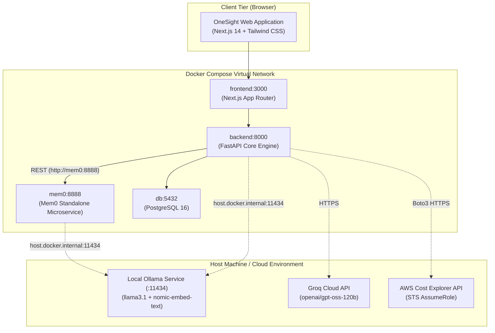
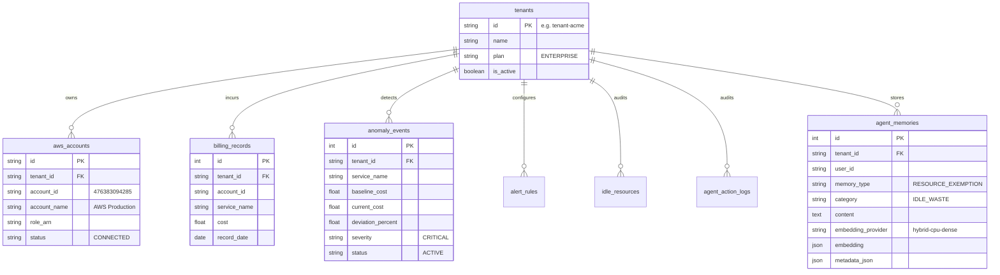

# OneSight (Costimizer) — Master Architecture & Technical Blueprint

> **Notice for AI Agents & Software Engineers:**  
> This document is the canonical technical authority for the **OneSight** (styled as *Costimizer* in the UI) codebase. Any agent or engineer joining this project must read this document to understand the system design, historical trajectory, architectural invariants, data models, and planned roadmap.

---

## 1. Project Overview & Vision

**OneSight** is an enterprise-grade, multi-tenant **Cloud Financial Management (FinOps) and Agentic AI Platform** purpose-built for AWS cloud environments (with GCP and Azure in roadmap). It bridges the gap between raw AWS Cost and Usage Reports (CUR) / AWS Cost Explorer APIs and actionable FinOps execution.

### Key Objectives
1. **Live AWS Telemetry Grounding (Zero-Mock Invariant):** All cost metrics, rolling burn rates, and month-end projections are strictly anchored in authentic AWS Cost Explorer daily spend records.
2. **Autonomous Cost Anomaly Detection & AI RCA:** Statistical anomaly detection (rolling 7-day Z-score + percentage surge) paired with autonomous Root Cause Analysis (RCA) that diagnoses suspect ARNs and CLI remediation scripts.
3. **Agentic FinOps Copilot:** A conversational AI agent that can reason across live AWS accounts, query cost explorer metrics, audit orphaned resources, and enforce organizational policies.
4. **Mem0 Persistent Memory Layer:** Multi-tenant episodic memory that learns team rules, budget ceilings, and resource exemptions (e.g. keeping disaster recovery volumes from being flagged as idle waste).
5. **Flexible Hybrid AI Inference:** Runs 100% offline via local **Ollama** (`llama3.1`), cloud LPUs via **Groq** (`openai/gpt-oss-120b`), **OpenAI**, or **Google Gemini**, with automated ReAct database heuristic fallback.

---

## 2. System Architecture & Topology



---

## 3. Technology Stack & Directory Layout

### Core Technologies
- **Frontend:** Next.js 14 (App Router), TypeScript, Tailwind CSS, Lucide React Icons, 44 Official AWS Architecture SVG Icons (64px).
- **Backend Core:** Python 3.12, FastAPI, SQLAlchemy 2.0, Pydantic v2, Boto3 (AWS SDK), Cryptography (Fernet AES-256 for credentials at rest).
- **Database:** Dual-mode support:
  - Development / Single-node: Local SQLite (`backend/onesight.db`).
  - Production / Multi-tenant: PostgreSQL 16 (`onesight-db`) with persistent Docker volume `onesight_pgdata`.
- **Memory & Vector Search:** Standalone Mem0 Microservice (`mem0/`), SQLite storage (`mem0.db` / `/data/mem0.db`), In-Process 128-dim CPU Feature Hashing Vectorizer, Cosine Similarity via NumPy.
- **AI Inference Engine:** Ollama (Local REST on 11434), Groq Cloud API, OpenAI API, Gemini API, local ReAct heuristic engine.

### Directory Structure
```
OneSight/
├── docker-compose.yml              # Multi-container orchestration (db, mem0, backend, frontend)
├── onesight-cft.yaml               # CloudFormation template for AWS customer cross-account role
├── start.bat / start.ps1           # Windows local startup scripts
├── docs/                           # Central architectural documentation
│   ├── MASTER_ARCHITECTURE.md      # Canonical architectural blueprint (this file)
│   ├── API_REFERENCE.md            # REST API endpoint catalog & contracts
│   └── AI_ONBOARDING_GUIDE.md      # Guidelines for incoming AI agents
├── backend/
│   ├── Dockerfile
│   ├── requirements.txt
│   ├── run.py                      # Uvicorn entrypoint
│   └── app/
│       ├── main.py                 # FastAPI application & startup lifecycle
│       ├── core/
│       │   ├── config.py           # Pydantic BaseSettings & env configuration
│       │   ├── database.py         # SQLAlchemy engine & session factory
│       │   └── security.py         # Fernet AES-256 encryption for AWS keys/roles
│       ├── models/
│       │   ├── tenant.py           # Tenant and AWSAccount models
│       │   ├── billing.py          # BillingRecord, IdleResource models
│       │   ├── anomaly.py          # AnomalyEvent, AnomalySeverity, AnomalyStatus
│       │   ├── alert.py            # AlertRule, AlertHistory models
│       │   └── agent.py            # AgentActionLog, AgentMemory models
│       ├── services/
│       │   ├── aws_cost_explorer.py # Cost Explorer queries & spend rollups
│       │   ├── aws_live_service.py  # Live AWS STS credential assuming & sync
│       │   ├── detector.py          # Z-score statistical cost anomaly detector
│       │   ├── agent_runtime.py     # FinOps Copilot reasoning engine & prompt injection
│       │   └── memory_service.py    # Mem0 client & adaptive in-process fallback
│       └── api/
│           ├── billing.py           # Cost Explorer & AWS onboarding endpoints
│           ├── anomalies.py         # Anomaly detection & RCA endpoints
│           ├── alerts.py            # Alert rules & webhook dispatcher endpoints
│           └── agents.py            # Copilot chat, AI config, and memory endpoints
├── mem0/
│   ├── Dockerfile                  # Standalone Mem0 microservice image
│   ├── requirements.txt
│   ├── server.py                   # Mem0 standalone FastAPI REST service (:8888)
│   └── cli.py                      # Mem0 terminal management CLI tool
└── frontend/
    ├── Dockerfile
    ├── package.json
    ├── public/
    │   └── aws-icons/              # 44 Official AWS Architecture SVG Icons (64px)
    └── src/
        ├── app/page.tsx            # Main application dashboard shell
        ├── types/index.ts          # TypeScript type definitions
        ├── lib/api.ts              # Frontend API client library
        └── components/
            ├── AWSServiceLogo.tsx   # Dynamic AWS official icon renderer with fallback
            ├── CostMap.tsx          # Spend topology density map with variance
            ├── AWSCostExplorer.tsx  # Cost explorer table & charts
            ├── AnomalyFeed.tsx      # Cost spike feed with RCA trigger
            ├── RCAModal.tsx         # AI Root Cause Analysis diagnosis modal
            ├── AgentChatConsole.tsx # FinOps Copilot chat console with Mem0 chips
            ├── SettingsView.tsx     # AI engine & Mem0 memory management dashboard
            └── MarkdownRenderer.tsx # GitHub Flavored Markdown renderer
```

---

## 4. Key Subsystems Implemented

### 4.1. Live AWS Cost Explorer & Onboarding
- **Cross-Account Security:** Customers connect their AWS accounts via standard AWS IAM Cross-Account Roles with an `ExternalId` and `SecurityAudit` + `ce:GetCostAndUsage` policies. Credentials and Role ARNs are encrypted at rest using AES-256 Fernet keys.
- **Automated CloudFormation:** [`onesight-cft.yaml`](file:///d:/One%20Data%20Solution/OneSight/onesight-cft.yaml) generates a 1-click AWS CloudFormation Stack creation URL for customer onboarding.
- **Telemetry Ingestion:** `AWSLiveCostExplorerService` queries daily unblended/amortized cost metrics grouped by `SERVICE`, populating the `billing_records` table with actual historical data for Account `476383094285` (24 AWS services).

### 4.2. Statistical Anomaly Detection Engine
Located in [`backend/app/services/detector.py`](file:///d:/One%20Data%20Solution/OneSight/backend/app/services/detector.py):
The detector evaluates rolling daily spend per service against a historical window:

$$\mu = \frac{1}{N} \sum_{i=1}^{N} C_i, \quad \sigma = \sqrt{\frac{1}{N} \sum_{i=1}^{N} (C_i - \mu)^2}$$

$$Z = \frac{C_{\text{today}} - \mu}{\sigma}$$

An anomaly is triggered if both conditions hold:
1. $Z \ge 2.5$ (or configured `DEFAULT_Z_SCORE_THRESHOLD`).
2. $\frac{C_{\text{today}} - \mu}{\mu} \times 100 \ge 35\%$ (minimum percentage jump).

Severity classification:
- **LOW:** $+35\%$ to $+70\%$
- **MEDIUM:** $+70\%$ to $+150\%$
- **HIGH:** $+150\%$ to $+300\%$
- **CRITICAL:** $> +300\%$ (e.g. Bedrock surge, runaway EC2 Auto-Scaling flapping)

### 4.3. Autonomous AI Copilot & Multi-Provider AI Engine
Located in [`backend/app/services/agent_runtime.py`](file:///d:/One%20Data%20Solution/OneSight/backend/app/services/agent_runtime.py):
- **Provider Switching:** Configurable live in Settings or directly via the chat console dropdown:
  - **Local Ollama:** `llama3.1` on `http://localhost:11434` (offline, 0 cloud cost).
  - **Groq Cloud:** `openai/gpt-oss-120b` or `qwen/qwen3.8-27b` (ultra-fast LPUs, ~500 tokens/sec).
  - **OpenAI:** `gpt-4o-mini` via standard API.
  - **Google Gemini:** `gemini-1.5-flash` via Google AI Studio API.
- **Live Grounding:** Injects actual MTD spend ($704.48), burn rates ($24.18/day), top spending AWS services, and active idle resources directly into the reasoning prompt.
- **Conversational Filter:** Prevents unsolicited telemetry dumps on casual greetings ("hi", "hello"), keeping answers focused and concise.

### 4.4. Mem0 Persistent Agent Memory Layer
Located in [`mem0/`](file:///d:/One%20Data%20Solution/OneSight/mem0) and [`backend/app/services/memory_service.py`](file:///d:/One%20Data%20Solution/OneSight/backend/app/services/memory_service.py):
- **Standalone Docker Microservice:** Runs as container `onesight-mem0` on port `8888` backed by volume `onesight_mem0data`.
- **Adaptive Multi-Tier Embedding Pipeline:**
  1. Local Ollama (`nomic-embed-text`) if available.
  2. Cloud Embeddings (`text-embedding-3-small` / Gemini) if API keys provided.
  3. **Guaranteed Fallback:** In-process CPU dense feature vectorizer (128-dim signed feature hashing with L2 normalization). Requires **zero** external servers, works for any tenant on any CPU.
- **Hybrid Semantic Search:** Combines cosine distance with keyword boosting and category boosts (`IDLE_WASTE`, `BUDGET`, `EC2`, `S3`).
- **Episodic Fact Extraction:** The Copilot recognizes directives like *"Remember that vol-0a88 is a DR backup disk"* and commits them to memory.
- **Context Injection:** Recalls active team policies and injects them into the Copilot's system prompt.
- **CLI Management Tool:** [`mem0/cli.py`](file:///d:/One%20Data%20Solution/OneSight/mem0/cli.py) allows running `status`, `list`, `search`, `add`, `delete`, and `clear` commands from PowerShell/Bash.

### 4.5. Official AWS Architecture 64px SVGs
Located in [`frontend/public/aws-icons/`](file:///d:/One%20Data%20Solution/OneSight/frontend/public/aws-icons/):
- 44 official AWS 64px architecture vector icons copied from the official AWS icon asset bundle.
- Component [`AWSServiceLogo.tsx`](file:///d:/One%20Data%20Solution/OneSight/frontend/src/components/AWSServiceLogo.tsx) automatically maps AWS service strings (`Amazon Elastic Compute Cloud - Compute`, `AmazonGuardDuty`, `Amazon Simple Storage Service`) to their respective SVG icons with fallback handling.

---

## 5. Database Schema & Entities



---

## 6. Docker Deployment & Orchestration

The platform is orchestrated via [`docker-compose.yml`](file:///d:/One%20Data%20Solution/OneSight/docker-compose.yml):

| Service | Container Name | Image / Build Context | Port | Volumes | Purpose |
| :--- | :--- | :--- | :--- | :--- | :--- |
| `db` | `onesight-db` | `postgres:16-alpine` | `5432:5432` | `onesight_pgdata` | Primary multi-tenant relational store |
| `mem0` | `onesight-mem0` | `./mem0` | `8888:8888` | `onesight_mem0data` | Standalone Agent Memory & Vector microservice |
| `backend` | `onesight-backend` | `./backend` | `8000:8000` | — | FastAPI FinOps Core Engine & Boto3 SDK |
| `frontend` | `onesight-frontend` | `./frontend` | `3000:3000` | — | Next.js 14 web application & dashboard |

### Common Docker Commands
```powershell
# Start the database alone (for lightweight local backend development)
docker compose up -d db

# Start Mem0 standalone microservice alone
docker compose up -d mem0

# Start entire OneSight stack
docker compose up -d

# View live container logs
docker compose logs -f backend mem0
```

---

## 7. Configuration & Environment Reference

The root `.env` and `.env.example` configure runtime settings:

| Variable | Default Value | Description |
| :--- | :--- | :--- |
| `DATABASE_URL` | `sqlite:///onesight.db` (local) / `postgresql://...` (docker) | Database connection string |
| `ACTIVE_LLM_PROVIDER` | `ollama` | Active inference provider (`ollama`, `groq`, `openai`, `gemini`) |
| `OLLAMA_BASE_URL` | `http://localhost:11434` (local) / `http://host.docker.internal:11434` (docker) | Local Ollama inference URL |
| `OLLAMA_MODEL` | `llama3.1` | Local LLM model tag |
| `GROQ_API_KEY` | *(blank)* | Groq Cloud API Key |
| `GROQ_MODEL` | `openai/gpt-oss-120b` | Groq model identifier |
| `MEM0_URL` | `http://localhost:8888` (local) / `http://mem0:8888` (docker) | Standalone Mem0 service URL |
| `ENCRYPTION_KEY` | `onesight-finops-secure-...` | AES-256 Fernet master encryption key |
| `AWS_DEFAULT_REGION` | `us-east-1` | Default AWS region for API client |

---

## 8. Invariants for AI Agents & Developers

When contributing to OneSight, the following rules are **mandatory**:

1. **Zero Mock Spend Data:** Never replace live AWS Cost Explorer records with randomized hardcoded fake numbers in production paths. Ground all spend figures in the real telemetry database.
2. **Strict Multi-Tenancy:** Every new database model, query, or memory lookup must include `tenant_id` filtering. Tenant A must never be able to read or mutate Tenant B's data.
3. **No Unsolicited Dumps:** Conversational AI responses must remain concise and brief for casual greetings. Detailed tables and spend breakdowns should only be rendered when explicitly requested.
4. **Resilient Adaptive Fallbacks:** AI and vector operations must never hard-crash if external cloud services (Ollama, Groq, OpenAI) are unreachable. Always implement clean local heuristic and CPU vector fallbacks.
5. **Secret Protection:** Never commit live API keys (`gsk_...`, `ghp_...`, AWS Access Keys) to Git tracking or `.env.example`.

---

## 9. Future Roadmap & Planned Features

The following capabilities are prioritized for future sprints:

1. **Multi-Cloud Ingestion:**
   - **Google Cloud Platform (GCP):** BigQuery Billing Export connector.
   - **Microsoft Azure:** Azure Cost Management Cost Details API connector.
2. **Real-Time Notification Dispatchers:**
   - Outbound webhook dispatchers for Slack Incoming Webhooks, Microsoft Teams Adaptive Cards, and PagerDuty Events API v2 for `CRITICAL` cost anomalies.
3. **Automated Jira / ServiceNow Incident Ticketing:**
   - Autonomous creation of engineering tickets when a statistical anomaly deviates by more than $+100\%$.
4. **AWS Tag-Level Dimension Explorer:**
   - Deep-dive spend filtering by `Environment` (`prod`, `staging`, `dev`), `CostCenter`, and `Owner` tags.
5. **Automated IAM Role Lifecycle:**
   - Cross-account automated trust verification health checks running every 12 hours.
