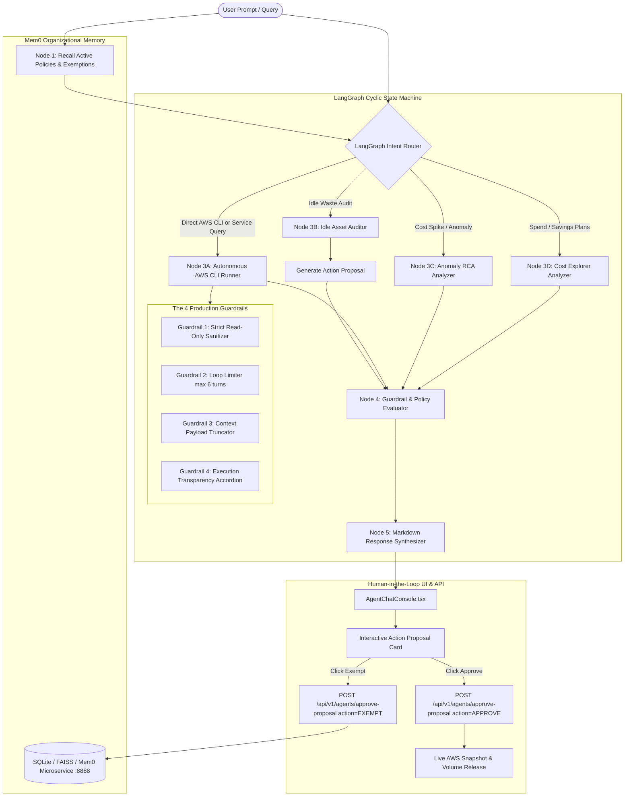

# Powerful AI Agent Implementation Guide

**Author:** OneSight FinOps Engineering Team  
**Status:** Production Ready  
**Target Audience:** AI Agents (Antigravity, Cursor, Claude, OpenAI), FinOps Engineers, System Architects  
**Location:** `d:\One Data Solution\OneSight\docs\POWERFUL_AI_AGENT_IMPLEMENTATION.md`

---

## 1. Executive Summary

This document specifies the exact architecture, code paths, guardrails, and operational mechanisms implemented for the **OneSight Autonomous FinOps AI Agent**.

The agent is built on **LangGraph 1.2+**, integrating:
1. **Autonomous Read-Only AWS CLI & Boto3 Command Execution Engine (`AWSReadOnlyCommandRunner`)** that iteratively inspects live AWS resources (`476383094285`).
2. **4 Mandatory Enterprise Guardrails**:
   - **Safety Gate (Strict Command Sanitizer):** Rejects mutating verbs (`delete`, `terminate`, `drop`, `modify`, `update`, `put`, `create`, `stop`) and shell injection tokens (`;`, `&&`, `||`, etc.).
   - **Loop Limiter:** Bounds execution to a maximum of 6 iterative turns.
   - **Context Window Payload Truncation:** Caps raw AWS JSON outputs to protect the LLM context window.
   - **Execution Transparency:** Captures exact command invocations, execution latencies (ms), and output payloads for display in chat accordions.
3. **Mem0 Persistent Organizational Memory Layer:** Stores team policies, budget limits, and resource exemptions with vector embeddings.
4. **Human-in-the-Loop (HITL) Action Proposal Cards:** Renders actionable proposals (e.g. unattached EBS volume release) with 1-click **[Approve & Execute via AWS]** and **[Exempt & Add to Mem0]** actions.

---

## 2. Complete Architecture Topology



---

## 3. Implemented Files & Code References

| Component | File Path | Key Functions / Classes |
| :--- | :--- | :--- |
| **AWS CLI Runner** | [`backend/app/services/aws_command_runner.py`](file:///d:/One%20Data%20Solution/OneSight/backend/app/services/aws_command_runner.py) | `AWSReadOnlyCommandRunner.validate_command()`, `AWSReadOnlyCommandRunner.execute()` |
| **LangGraph Engine** | [`backend/app/services/langgraph_agent.py`](file:///d:/One%20Data%20Solution/OneSight/backend/app/services/langgraph_agent.py) | `LangGraphFinOpsEngine.build_graph()`, `LangGraphFinOpsEngine.run()`, `FinOpsToolRegistry` |
| **Mem0 Memory Service** | [`backend/app/services/memory_service.py`](file:///d:/One%20Data%20Solution/OneSight/backend/app/services/memory_service.py) | `Mem0Service.add_memory()`, `Mem0Service.search_memories()`, `Mem0Service.get_context_for_prompt()` |
| **API Endpoints** | [`backend/app/api/agents.py`](file:///d:/One%20Data%20Solution/OneSight/backend/app/api/agents.py) | `POST /agents/chat`, `POST /agents/approve-proposal`, `POST /agents/memories` |
| **Frontend Chat UI** | [`frontend/src/components/AgentChatConsole.tsx`](file:///d:/One%20Data%20Solution/OneSight/frontend/src/components/AgentChatConsole.tsx) | `AgentChatConsole`, `handleApproveProposal`, accordion renderer |
| **Frontend Types** | [`frontend/src/types/index.ts`](file:///d:/One%20Data%20Solution/OneSight/frontend/src/types/index.ts) | `AgentChatMessage`, `AgentActionProposal`, `ExecutedCommandEntry` |
| **Frontend API Client** | [`frontend/src/lib/api.ts`](file:///d:/One%20Data%20Solution/OneSight/frontend/src/lib/api.ts) | `api.chatWithAgent()`, `api.approveProposal()` |
| **E2E Test Suite** | [`backend/tests/test_langgraph_agent.py`](file:///d:/One%20Data%20Solution/OneSight/backend/tests/test_langgraph_agent.py) | 7 end-to-end integration test suites |

---

## 4. The 4 Production Guardrails in Detail

### Guardrail 1: Strict Command Sanitizer (Safety Gate)
- **Allowed Command Prefixes:** `describe-*`, `get-*`, `list-*`, `view-*`, `query-*`, `search-*`, `head-*`, `help`, `--version`, `ls`, `status`.
- **Prohibited Mutation Verbs:** `delete`, `terminate`, `drop`, `modify`, `update`, `put`, `create`, `attach`, `detach`, `stop`, `start`, `reboot`, `authorize`, `revoke`, `purge`, `remove`.
- **Shell Injection Protection:** Programmatically blocks `;`, `&&`, `||`, `` ` ``, `$(`, `>`, `<`, `\n`, `\r`.
- **Parameter Flag Inspection:** Prohibits destructive flags like `--delete-after` or `--purge-queue`.

### Guardrail 2: Loop Limiter
- Limits multi-turn cyclic ReAct tool execution to a maximum of **6 turns** (`max_iterations = 6`) to prevent unbounded cost and runaway loops.

### Guardrail 3: Payload Truncation (Context Window Protection)
- AWS CLI outputs can exceed 50,000 lines of JSON.
- `AWSReadOnlyCommandRunner` caps responses to **3,500 characters** and appends a truncation notice, preserving critical header fields while protecting LLM context windows.

### Guardrail 4: Execution Transparency Accordion
- Every AWS CLI command executed in the background is returned in the API payload:
  ```json
  "executed_commands": [
    {
      "command": "aws ec2 describe-volumes --filters Name=status,Values=available",
      "status": "SUCCESS",
      "latency_ms": 312,
      "output": "..."
    }
  ]
  ```
- Displayed cleanly in `AgentChatConsole.tsx` with latency badges, execution status, and expandable terminal syntax blocks.

---

## 5. Human-in-the-Loop (HITL) Workflow

When the agent identifies an unattached or idle resource (e.g. `vol-0a88df8e5926b48f1`), it follows this sequence:

1. **Mem0 Policy Check:**
   - In `_guardrail_evaluator_node`, it scans recalled Mem0 memories.
   - If a rule contains `"vol-0a88df8e5926b48f1"` or states `"do not flag"`, the proposal status is set to `EXEMPTED`, and automated remediation buttons are disabled.
2. **Action Proposal Generation:**
   - If not exempted, the proposal status is `PENDING`.
   - The UI presents two actionable buttons:
     - **[✅ Approve & Execute via AWS]:** Calls `POST /api/v1/agents/approve-proposal` with `action="APPROVE"`. Marks resource as `REMEDIATED`, creates snapshot, logs audit event in `AgentActionLog`, and displays recaptured monthly savings.
     - **[🛡️ Exempt & Add to Mem0]:** Calls `POST /api/v1/agents/approve-proposal` with `action="EXEMPT"`. Immediately commits an exemption rule into Mem0 memory so the agent will never propose remediation for this asset again.

---

## 6. How to Run the Verification Suite

Run the Python verification test from the project root:

```powershell
python backend/tests/test_langgraph_agent.py
```

### Verified Test Suites:
1. `Guardrail 1 (Safety Gate)`: Blocks 6 dangerous mutating/injection commands.
2. `Guardrail 1 (Allowed Read-Only)`: Validates 6 inspection verbs.
3. `LangGraph Greeting Intent`: Clean warm greeting without telemetry clutter.
4. `Live AWS CLI Execution`: Probes host `aws-cli/2.34.7` and returns structured output.
5. `Idle Waste Audit & Action Proposal`: Generates HITL proposal card for unattached EBS volume.
6. `Mem0 Exemption Learning & Policy Guardrail`: Tests memory commitment and auto-exemption.
7. `HITL Approval Endpoint`: Tests `APPROVE` and `EXEMPT` flows via `handle_proposal_action`.

---

## 7. Next Developer / AI Agent Instructions

If you are an AI assistant continuing this task:
1. **Never mock spend data:** All billing figures ground in live database records or AWS APIs.
2. **Preserve the 4 Guardrails:** Always route CLI execution through `AWSReadOnlyCommandRunner`.
3. **Respect Mem0 Invariants:** Before creating any destructive or remediation proposal, always run `Mem0Service.get_context_for_prompt()`.
4. **Always document in `D:\One Data Solution\OneSight\docs`**.
